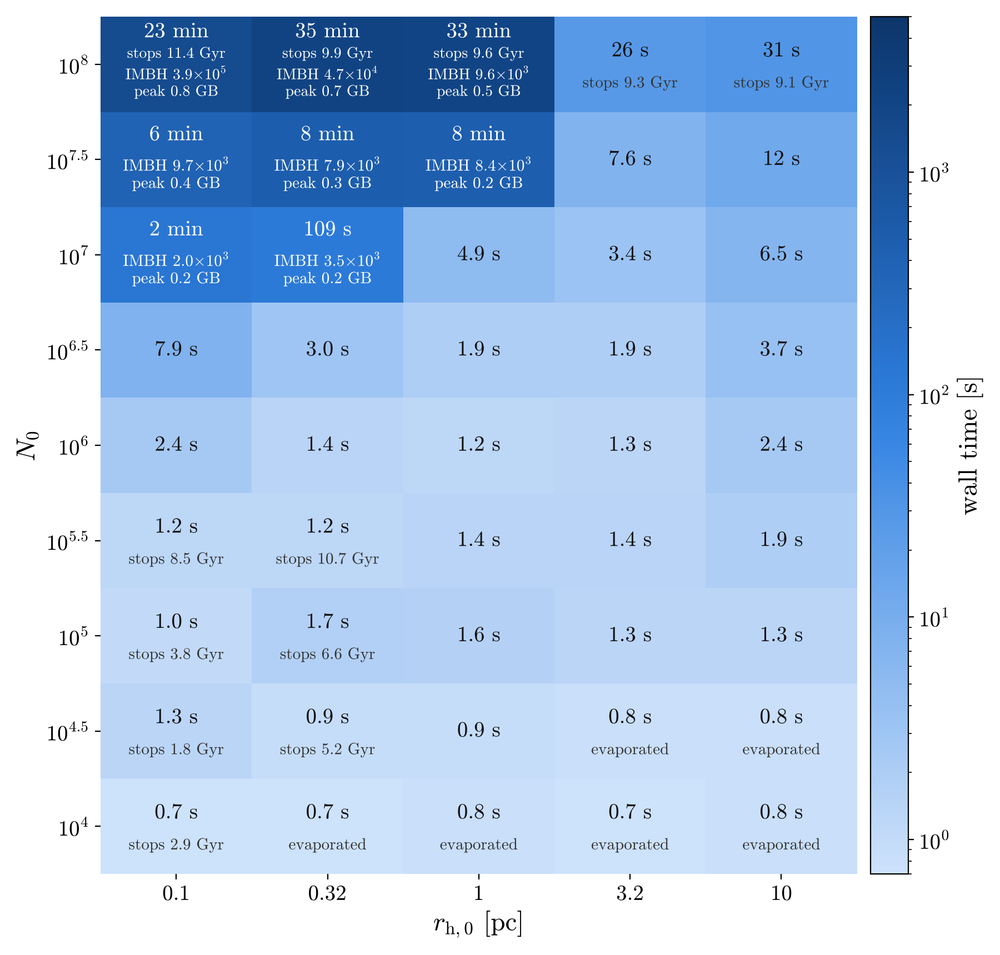

# Rapster

<p align="center">
	<a href="https://github.com/Kkritos/Rapster/releases"></a>
	<a href="https://arxiv.org/abs/2210.10055"></a>
	<a href="https://arxiv.org/abs/2212.06845"></a>
	<a href="https://arxiv.org/abs/2605.21593"></a>
	<a href="https://arxiv.org/abs/2609.26878"></a>
	<a href="https://doi.org/10.5281/zenodo.23429403"></a>
	<a href="https://github.com/Kkritos/Rapster/blob/main/LICENSE"></a>
	
	<a href="https://github.com/Kkritos/Rapster/actions/workflows/tests.yml"></a>
	<a href="https://github.com/Kkritos/Rapster"></a>
	<a href="https://github.com/Kkritos/Rapster/commits/main"></a>
</p>

Rapid population synthesis code for compact object coalescences and tidal disruptions in dynamical environments.

$\tt Rapster$ stands for $\rm RAPid\ cluSTER$ evolution.
(Thanks to Mark Cheung for coming up with the shorthand version!)

Author: Konstantinos Kritos <konstantinos.kritos@stonybrook.edu>

Version: 2.16.0, October 29, 2026.
(Thanks to Tousif Islam for helping modularize this repository!)


(Thanks to Hector Cruz for digitizing my hand-drawn logo!)

### Contents:
1. [Overview](#overview)
2. [Requirements](#requirements)
3. [Units](#units)
4. [Input parameters](#inputparameters)
5. [Running a simulation](#runningasimulation)
6. [Multiple stellar populations](#populations)
7. [Checkpoints and restarts](#restarts)
8. [Run time and memory](#runtime)
9. [Output files](#outputfiles)
10. [Applications of the code](#applicationsofthecode)
11. [Citing this work](#citingthiswork)
12. [Reporting bugs](#reportingbugs)
13. [Thank you](#thanks)

---

<a name="overview"></a>
### 1. Overview

The repository provides the source code files for the current version in ``rapster/`` and all necessary data files in the ``Data/`` folder, for the rapid evolution of dense star cluster environments and the dynamical assembly of compact-object coalescences and tidal disruption events.

The modeling accounts for the necessary physical processes governing the formation of compact-object binaries and cluster evolution, employing semi-analytic prescriptions described in Sec. 2 of [K. Kritos et al. PRD (2024)](https://arxiv.org/abs/2210.10055). This is our code paper, written with Vladimir Strokov, Vishal Baibhav, and Emanuele Berti.

##### New in version 2.16.0:

Faster for compact clusters, with statistically equivalent results: about 2x vs version 2.15.0 for the most compact massive clusters, dominated by BH-star TDEs and GW captures (e.g. 513 -> 267 s for the full run of N = 10^7.5, r = 0.1 pc; 155 -> 79 s for the first 25 Myr of N = 1e8, r = 0.1 pc), unchanged for ordinary clusters. A given seed can give another realization than version 2.15.1 (only time steps with several BH-star TDEs or GW captures, and pools of more than ~1.3e5 single BHs, use the random numbers differently), with the same distributions (see ``CHANGELOG.md`` for the validation). The tables are now written to their files by a separate process while the simulation continues.

##### New in version 2.15.1:

Faster, with byte-identical results: 1.1-1.5x faster for compact clusters (e.g. 515 -> 396 s for the full run of N = 10^7.5, r = 0.1 pc), unchanged for ordinary clusters (see ``CHANGELOG.md``).

##### New in version 2.15.0:

Easier set-ups for users. Stellar populations born after the first one can be added with ``-POP``, each with its own birth time, number of stars, metallicity and star formation efficiency, and optionally born more concentrated than the cluster (see [Multiple stellar populations](#populations)). A run writes checkpoints from which it can be restarted, to continue a run stopped by a wall-time limit, to extend it, or to change the seed or the half-mass radius and add BHs or a new population (see [Checkpoints and restarts](#restarts)). The gas expulsion time is now given in Myr (``-tge``, replacing ``-fge``), a cluster can be placed at the galactic center (``-R 0``) or continue there after its inspiral (``-GC 1``), and the maximum mass fraction in compact objects is an option (``-fCO``), which now counts the compact objects in binaries, triples and BH-star pairs too. Single-population runs are byte-identical to version 2.14.3 except where these fixes apply (see ``CHANGELOG.md``).

##### New in version 2.14.3:

A ZLK merger of a hierarchical triple that would happen after redshift 0 is no longer counted (the triple is kept; previously its BHs could also be lost from the cluster), ``log.txt`` now states why every run ended, including the previously silent stops when single BHs reach a fraction ``fBH_max`` = 0.2 of the cluster mass or the maximum time ``-tM`` is reached, and the merger table is also written during the run. Results are otherwise byte-identical to version 2.14.2 (see ``CHANGELOG.md``).

##### New in version 2.14.2:

The evolution, hardening and TDE tables are written to disk during the run, so memory no longer grows with the number of recorded events (e.g. a peak of 1.2 GB instead of 4.8 GB for N = 1e8, r = 0.1 pc), and compact clusters that form IMBHs run 1.2-1.3x faster. Results are byte-identical to version 2.14.1 (see ``CHANGELOG.md``).

##### New in version 2.14.1:

The marginally bound radius of TDE orbits (``r_mb`` in ``tdes.txt``) is now computed exactly for Kerr BHs; the former lookup table assigned wrong values to prograde orbits and ``nan`` to all retrograde ones (output only; the dynamics are unchanged). Clusters dominated by tidal disruptions run ~1.3x faster with less memory, with otherwise byte-identical results (see ``CHANGELOG.md``).

##### New in version 2.14.0:

Six bugs of version 2.13.1 are fixed; most importantly, three-body binaries now pair the BHs with the intended mass weighting, so that the heaviest BHs pair first (see ``CHANGELOG.md`` for all fixes). The code is also considerably faster: about 2x for typical clusters and 4-8x for compact clusters (large $N$, small $r$), including those that grow an intermediate-mass black hole, compared with version 2.13.1 with the same bug fixes. For a given seed the results differ from those of version 2.13.1, with the same statistical properties as the corrected code (see ``CHANGELOG.md`` for the validation).

##### Note:

For computational efficiency, the folder ``Data/MzamsMrem/`` contains 12 files with pre-calculated look-up tables of stellar remnant masses on a grid of zero-age main sequence values up to $340M_\odot$ and 12 values of absolute metallicity in the range from $10^{-4}$ to $1.7\times10^{-2}$ as calculated with the $\tt SEVN$ code [M. Spera & M. Mapelli (2017)](https://academic.oup.com/mnras/article/470/4/4739/3883764).

In the current version, we have also included lookup tables for the Mandel-Muller and Fryer et al. (2012) delayed- and rapid-remnant mass prescription models in the files ``Mueller_Mandel.txt``, ``MzamsMrem_F12d.txt``, and ``MzamsMrem_F12r.txt``, respectively.

Moreover, ``Data/Planck18_lookup_table.npz`` is a lookup table for the redshift-lookback time and lookback time-redshift relations assuming the Planck 2018 cosmology.

Finally, ``Data/APR.txt``, ``Data/AU.txt``, ``Data/APR4.txt``, ``Data/MPA1.txt`` and ``Data/DD2.txt`` contain lookup tables for the corresponding NS equations of state, radius (in km) as a function of NS mass (Msun), tabulated along the stable branch up to the TOV maximum mass.

The available equations of state are in the ``EOS_TABLES`` registry in ``rapster/compact_accretion.py``, which maps each name to its table file in ``Data/``. To add another EoS, place its table there and add one entry to that dictionary; the ``-EoS`` flag then accepts the new name automatically. The ``APR4``, ``MPA1`` and ``DD2`` tables were generated from precomputed TOV sequences by ``Data/.tovseq_to_eos.py``, which documents the reduction applied.

``Data/NS_formation.npz`` tabulates the distribution of NS formation times, overall and in NS-mass bins of $0.05M_\odot$, from a $\tt COMPAS$ population of $10^8$ binaries at solar metallicity ($27.5$ million NSs with masses $1.26$-$2.50M_\odot$; half of them form by $25\,\rm Myr$). It is used with ``-NSt 1`` and ``-NSt 2`` (see Input parameters) and was built with ``tools/make_ns_formation_table.py``, which can generate tables for other population-synthesis models.

All stellar-mass BHs are assumed to form $10\,\rm Myr$ after cluster formation (``tBH_form`` in ``rapster/constants.py``), when the BH subsystem is activated. NSs either form at the same time (``-NSt 0``, default) or over an extended time interval drawn from the table above (``-NSt 1/2``); in the latter case each NS is retained if its natal kick is below the escape velocity at its formation time.

Developer tools that are not part of the installed package are in ``tools/``, and tests are in ``tests/`` (see Running a simulation).

##### Abbreviations:

- BH: black hole
- NS: neutron star
- WD: white dwarf
- BBH: binary black hole
- CBC: compact binary coalescence
- GW: gravitational wave
- TDE: tidal disruption event
- EoS: equation of state

<a name="requirements"></a>
### 2. Requirements

Rapster supports Python >= 3.10. Its declared dependencies are:

- $\tt numpy$ (>=1.26)
- $\tt scipy$ (>=1.11)
- $\tt pandas$ (>=2.1)
- $\tt matplotlib$
- $\tt astropy$
- $\tt jupyterlab$ and $\tt ipykernel$ (for the tutorial notebook)

The minimum NumPy, SciPy, and pandas versions are set in ``pyproject.toml``; the other listed dependencies have no version requirement. The tests pass on Python 3.10-3.13 with current NumPy 2.x and SciPy releases. Matplotlib is imported only when plots are requested (``-plot 1``). JupyterLab and ipykernel are only needed to run the tutorial notebook in ``Example/``.

First, create an environment called ``.rapsterenv`` in the root directory of the repository Rapster/, and hidden from view:

```bash
python3 -m venv .rapsterenv
```

If you use a different name, please add the environment name as a new row in .gitignore, since the environment folder should never be pushed to the repository.

To activate this environment:

```bash
source .rapsterenv/bin/activate
```

To install ``rapster`` and all requirements, run:

```bash
pip install -e .
```

Verify the installation (along with dependencies) and package version:

```bash
pip list
```

Finally, include the virtual environment in the kernel:

```bash
python -m ipykernel install --user --name=rapsterenv --display-name "Python (.rapsterenv)"
```

To install Rapster with the optional ``gwModel_kick_prec_flow`` recoil kick dependency (``-RK 1``), run this from the repository root:

```bash
pip install -e '.[gwkick]'
```

<a name="units"></a>
### 3. Units

The current version of the code uses astrophysical units (unless stated otherwise); see, e.g., [Heggie & Hut (2003)](https://ui.adsabs.harvard.edu/abs/2003gmbp.book.....H/abstract):

 - Mass: solar mass ($M_\odot$)
 - Distance: parsec ($\rm pc$)
 - Time: million years ($\rm Myr$)
 - Velocity: $\rm km\ s^{-1}\approx pc\ Myr^{-1}$
 - Gravitational constant: $G=1/232$
 - Speed of light: $c=3\times10^5$

<a name="inputparameters"></a>
### 4. Input parameters

The code accepts parameters with flag options.

For a description of all input parameters, run the following command in the command line interface:

```bash
python -m rapster.run_cluster --help
```

For the user’s convenience, we paste the list of optional arguments in the form of a Table here as well:

| Flag | Description | Type | Default |
|:--- |:--- |:--- |:--- |
| -N, --number | Initial number of stars | float | ``1000000`` |
| -r, --half_mass_radius | Initial half-mass radius [pc] | float | ``1`` |
| -mm, --minimum_star_mass | Smallest ZAMS mass [Msun] (not below 0.08 suns) | float | ``0.08`` |
| -mM, --maximum_star_mass | Largest ZAMS mass [Msun] (not above 340 suns) | float | ``150`` |
| -Z, --metallicity | Absolute metallicity | float | ``0.001`` |
| -z, --cluster_formation_redshift | Redshift of cluster formation | float | ``3.0`` |
| -n, --central_stellar_density | Initial central stellar number density [pc^-3] | float | Plummer value ``0.53 N / r^3`` (``5.3e5`` for the default N and r) |
| -fb, --binary_fraction | Initial binary star fraction | float | ``0.1`` |
| -S, --seed | Seed number | int | ``1234567890`` |
| -dtm, --minimum_time_step | Minimum simulation time-step [Myr] | float | ``0.1`` |
| -dtM, --maximum_time_step | Maximum simulation time-step [Myr] | float | ``50.0`` |
| -tM, --maximum_time | Maximum simulation time [Myr] | float | ``14000.0`` |
| -fCO, --max_compact_object_fraction | The simulation stops when the mass in compact objects (single BHs and NSs and those in binaries, triples and BH-star pairs) exceeds this fraction of the stellar mass of the cluster (see Stopping conditions below) | float | ``0.2`` |
| -wK, --supernova_kick_parameter | One-dimensional supernova kick parameter [km/s] | float | ``265.0`` |
| -K, --natal_kick_prescription | Natal kick prescription (0 for fallback, 1 for momentum conservation) | int | ``1`` |
| -R, --galactocentric_radius | Initial galactocentric radius [pc]; ``0`` places the cluster at the galactic center, without galactic tides or dynamical friction (e.g. a nuclear star cluster, see below) | float | ``8000.0`` |
| -vg, --galactocentric_velocity | Galactocentric circular velocity [km/s] | float | ``220.0`` |
| -GC, --continue_at_galactic_center | When the cluster reaches the galactic center by dynamical friction: ``0`` to stop the simulation, ``1`` to continue it at the center without galactic tides | int | ``0`` |
| -s, --spin_parameter | Natal spin parameter of first generation (1g) BHs | float | ``0.0`` |
| -SD, --spin_distribution | Natal spin distribution model (0 for uniform, 1 for monochromatic, 2 for beta) | int | ``0`` |
| -P, --print_information | Print runtime information (0 for no, 1 for yes) | int | ``1`` |
| -Mi, --mergers_file_indicator | Export mergers file (0 for no, 1 for yes) | int | ``1`` |
| -MF, --mergers_file_name | Name of .txt output file with BBH merger source parameters | str | ``mergers`` |
| -Ei, --evolution_file_indicator | Export evolution file (0 for no, 1 for yes) | int | ``1`` |
| -EF, --evolution_file_name | Name of .txt output file with time-dependent quantities | str | ``evolution`` |
| -Hi, --hardening_file_indicator | Export hardening file (0 for no, 1 for yes) | int | ``1`` |
| -HF, --hardening_file_name | Name of .txt output file with BBH time evolution information | str | ``hardening`` |
| -BIi, --blackholes_in_file_indicator | Use external BH file (0 for no, 1 for yes) | int | ``0`` |
| -BIF, --blackholes_in_file_name | .npz archive containing a one-dimensional ``mBH_ini`` array of initial BH masses [Msun] | str | ``input_BHs.npz`` |
| -BOi, --blackholes_out_file_indicator | Export BH masses file (0 for no, 1 for yes) | int | ``1`` |
| -BOF, --blackholes_out_file_name | Name of the .pkl file containing all BH masses in solar masses | str | ``outputBHs`` |
| -RP, --remnant_mass_prescription | Remnant mass prescription (0 for SEVN delayed, 1 for Fryer+2012 delayed, 2 for SEVN rapid, 3 for Fryer+2012 rapid) | int | ``1`` |
| -NS, --with_neutron_stars | Include neutron stars (if =1 with monochromatic at 1.4 suns by default, =2 with bimodal NS mass distribution from Rocha et al. 2023, or =3 with uniform NS mass distribution between the minimum NS mass and the TOV mass of the chosen EoS) else no (if =0); the NS formation times are set by -NSt | int | ``2`` |
| -NSt, --ns_formation_time_model | NS formation-time model (0 for all NSs at the BH formation time of 10 Myr, 1 for times drawn from the COMPAS distribution $p(t)$ in ``Data/NS_formation.npz``, 2 for times drawn from $p(t\,\vert\,m_{\rm NS})$, i.e. correlated with the NS mass); requires -NS 1, 2 or 3 | int | ``0`` |
| -WT, --with_tdes | Include tdes (if =1) else no (if =0) | int | ``1`` |
| -Ti, --tdes_file_indicator | Export tdes file (0 for no, 1 for yes) | int | ``1`` |
| -TF, --tdes_file_name | Name of .txt file containing tde parameters | str | ``tdes`` |
| -MBH, --massive_black_hole_mass | Mass of the seed massive BH (if >0) | float | ``0`` |
| -sBH, --massive_black_hole_spin | Spin of the seed massive BH (from 0 to 1) | float | ``0`` |
| -RF, --results_folder_name | Name of the folder where output files will be exported | str | ``Results`` |
| -BMD, --bh_mass_distribution | Initial BH mass distribution (0 for Kroupa+collapse, 1 for uniform, 2 for Salpeter, 3 for log-uniform) | int | ``0`` |
| -mBH1gMin, --min_1g_bh_mass | Minimum 1g BH mass for uniform/Salpeter/log-uniform sampling [Msun] | float | ``3.0`` |
| -mBH1gMax, --max_1g_bh_mass | Maximum 1g BH mass for uniform/Salpeter/log-uniform sampling [Msun] | float | ``60.0`` |
| -RMP, --random_mass_pairing_2body_3body | Use uniform random pairing for 3bb and 2-body capture (0 for no, 1 for yes) | int | ``0`` |
| -plot, --generate_plots | Generate diagnostic plots after simulation (0 for no, 1 for yes) | int | ``0`` |
| -analyze, --analyze_results | Print analysis summary after simulation (0 for no, 1 for yes) | int | ``0`` |
| -fA, --accreted_fraction | Fraction of a disrupted star accreted by the compact object | float | ``0.5`` |
| -mb, --mass_bias_power | Mass bias power index p for drawing stars from IMF*m^p for TDEs | float | ``0.0`` |
| -EoS, --equation_of_state | Neutron Star equation of state; one of "APR", "APR4", "AU", "DD2", "MPA1" (the keys of ``EOS_TABLES``) | str | ``APR`` |
| -RK, --recoil_kick_model | GW recoil kick model (0 for Gerosa & Kesden 2016, 1 for gwModel_kick_prec_flow from Islam & Wadekar 2025) | int | ``0`` |
| -sfe, --star_formation_efficiency | Star formation efficiency epsilon in (0,1]; sets initial residual gas mass. Default 1.0 = no gas (recovers gas-free Rapster) | float | ``1.0`` |
| -tge, --gas_expulsion_time | Gas expulsion timescale [Myr] (the residual gas mass decays as $e^{-t/t_{\rm ge}}$) | float | ``10.0`` |
| -fEdd, --eddington_ratio_cap | Eddington ratio ceiling for gas accretion onto compact objects (1.0 = hard Eddington cap) | float | ``1.0`` |
| -cs, --gas_sound_speed | Gas sound speed [km/s] | float | ``10.0`` |
| -fesc, --escape_velocity_factor | Escape-velocity prefactor $f$ in $v_{\rm esc}=f\sqrt{\langle v_\star^2\rangle+\langle v_{\rm BH}^2\rangle}$; $f=2$ is the rms escape speed, $f=\sqrt{10}$ gives $\sqrt{4GM_{\rm cl}/r_{\rm h}}$ (Mai et al. 2025) | float | ``2.0`` |
| -cxi, --bh_temperature_prefactor | Prefactor $c_\xi$ of the BH-to-star temperature ratio $\xi=c_\xi q^{3/5}Q^{2/5}(\ln\Lambda_{\rm BH}/\ln\Lambda)^{-2/5}$ (Breen & Heggie 2013); $r_{\rm h,BH}$ scales as $1/c_\xi$ | float | ``1.0`` |
| -POP, --populations_file | Text file of stellar populations born after $t=0$, one per line: ``t_birth N [Z] [SFE] [x] [n_mix]`` (see [Multiple stellar populations](#populations)) | str | none |
| -POPi, --populations_file_indicator | Export the populations file when ``-POP`` is given (0 for no, 1 for yes) | int | ``1`` |
| -POPF, --populations_file_name | Name of .txt output file with the properties of each stellar population | str | ``populations`` |
| -CKi, --checkpoint_indicator | Write ``checkpoint.pkl`` every ``-CKdt`` Myr and at the end of the run (0 for no, 1 for yes; see [Checkpoints and restarts](#restarts)) | int | ``1`` |
| -CKdt, --checkpoint_interval | Simulated time between checkpoints [Myr] | float | ``500.0`` |
| -RS, --restart_from | Restart from the checkpoint in this results folder (or this checkpoint file), writing to a new folder ``-RF`` | str | none |
| -addBH, --add_black_holes_file | Restart only: .npz archive with an array ``mBH`` of BH masses [Msun] to add, and optionally an array ``sBH`` of their spins | str | none |
| -addN, --add_number | Restart only: number of stars of a new stellar population born at the restart | float | none |
| -addZ, --add_metallicity | Restart only: metallicity of that population | float | that of the cluster |
| -addSFE, --add_star_formation_efficiency | Restart only: star formation efficiency of that population | float | ``1.0`` |
| -addx, --add_radius_ratio | Restart only: its half-mass radius relative to that of the cluster (1: well mixed) | float | ``1.0`` |
| -addnmix, --add_mixing_time | Restart only: its mixing time if segregated, in half-mass relaxation times | float | ``5.0`` |


##### Note:

Unless it is given with ``-n``, the initial central stellar density is set to the value of a Plummer density profile with the chosen number of stars $N$ and half-mass radius $r$: $n=3(1.3)^3N/(4\pi r^3)\simeq0.53N/r^3$, i.e. 5.3e5 pc^-3 for the default $N=10^6$ and $r=1\,\rm pc$. The value used is printed at the top of ``log.txt``. The cluster then evolves homologically, by assumption. If you prefer an alternative stellar density profile, a different relation may hold between $N$ and $r$; pass the density explicitly with ``-n``. (Up to version 2.13.1 the default was 5.3e5 pc^-3 whatever the values of ``-N`` and ``-r``.)

##### Nuclear star clusters:

The galaxy enters the evolution only through the tidal (Jacobi) radius of the cluster, which sets its escape rate, and through the dynamical friction that drags it inward. To simulate a cluster at the center of its galaxy, such as a nuclear star cluster, use ``-R 0``: the cluster then evolves without galactic tides (the escape rate of an isolated cluster) and does not move. A cluster that starts at ``-R`` > 0 and reaches the center by dynamical friction stops there by default (``CLUSTER REACHED GALAXY CENTER`` in ``log.txt``); with ``-GC 1`` the run continues from that point as a cluster at the center, without galactic tides. In reality such a cluster would merge with the nuclear star cluster already present, which is not modeled.

##### Stopping conditions:

A simulation ends when one of the following happens, and the reason is written in ``log.txt``:
- ``REDSHIFT 0 REACHED``: the present day.
- ``MAXIMUM SIMULATION TIME REACHED``: the time ``-tM``.
- ``CLUSTER DISSOLVED``: the stellar mass (or the half-mass radius) of the cluster drops to zero.
- ``CLUSTER REACHED GALAXY CENTER``: by dynamical friction (unless ``-GC 1``).
- ``BH SUBSYSTEM EVAPORATED``: no BHs are left (and none are still to form: NSs with ``-NSt 1/2``, or BHs and NSs of stellar populations born later, see ``-POP``).
- ``COMPACT OBJECTS REACHED A FRACTION fCO_max ... OF THE CLUSTER MASS``: the BHs and NSs (single, in binaries, triples and BH-star pairs) exceed the fraction ``-fCO`` of the stellar mass. Beyond this point the compact objects dominate the cluster and the assumptions behind the Breen & Heggie (2013) energy-flow balance used for the BH subsystem no longer hold; a larger ``-fCO`` extrapolates the model into that regime.

<a name="runningasimulation"></a>
### 5. Running a simulation

##### Examples:

Run with default parameters:

```bash
python -m rapster.run_cluster
```

Run with analysis summary printed at the end:

```bash
python -m rapster.run_cluster -analyze 1
```

Run with both analysis summary and diagnostic plots:

```bash
python -m rapster.run_cluster -analyze 1 -plot 1
```

Run silently (no screen output, all output saved to ``Results/log.txt``):

```bash
python -m rapster.run_cluster -P 0
```

Run with beta spin distribution and random mass pairing:

```bash
python -m rapster.run_cluster -SD 2 -s 1.0 -RMP 1
```

Run with bimodal NS masses and NS formation times correlated with NS mass:

```bash
python -m rapster.run_cluster -NS 2 -NSt 2
```

The numbers of NSs formed and retained are printed at the end of ``log.txt``.

##### Testing:

For a lightweight smoke test, run:

```bash
python -m rapster.run_cluster -N 100 -tM 1 -dtM 1 -P 0 -Mi 0 -Ei 0 -Hi 0 -BOi 0 -Ti 0 -plot 0 -analyze 0 -RF Results_smoke
```

This creates ``Results_smoke/log.txt``. To reproduce the bundled reference outputs, run the default configuration; the full default simulation is substantially larger than the smoke test.

To run the tests (from the repository root, with ``pytest`` installed via ``pip install pytest``):

```bash
python3 -m pytest tests/
```

Each test file can also be run on its own, e.g. ``python3 tests/test_regression.py``. The tests are also run automatically by GitHub Actions on Python 3.10-3.13 for every push and pull request.

- ``tests/test_regression.py`` runs the default configuration with a fixed seed and checks that key results (numbers of mergers, TDEs, retained and ejected BHs; final cluster mass, half-mass radius and maximum BH mass) match stored reference values. If a change is meant to alter results, regenerate the reference values with ``python3 tests/test_regression.py --update`` and note the change in ``CHANGELOG.md``.
- ``tests/test_ns_formation.py``, ``tests/test_ns_initialization.py`` and ``tests/test_ns_main_loop.py`` test the NS formation-time sampler, the NS initialization and NS formation in the main loop.
- ``tests/test_ns_physics.py`` compares the number of retained NSs in a full run with the analytic expectation from the natal-kick distribution and the escape velocity of the evolving cluster.
- ``tests/test_fixes.py`` checks the fixes listed in ``CHANGELOG.md`` (three-body binary mass distribution, reproducible beta spins, hardening and TDE files, BH snapshots, default central density).
- ``tests/test_exact_speedups.py`` and ``tests/test_exact_samplers.py`` check the bit-exact optimizations: each fast routine is compared with the straightforward implementation it replaces (same values and same consumption of the random-number stream), including large and changing BH populations and random numbers placed on the boundaries of the cumulative distributions.
- ``tests/test_populations.py`` checks multiple stellar populations: the ``-POP`` file, the bookkeeping of the populations (masses, numbers of stars, stellar-evolution mass loss, the shares of the escaping mass, mixing of segregated populations, WD formation), the drawing of field stars from several populations, and whole runs (population rows in step with the evolution rows and adding up to the cluster mass, BHs of a later population, unchanged results when no second population is born, and a cluster born as two halves 0.1 Myr apart compared with a single population).
- ``tests/test_restart.py`` checks checkpoints and restarts: a run stopped abruptly after a checkpoint, restarted and joined, and a run continued twice from its final checkpoint, give byte-identical files to an uninterrupted run; the changes allowed at a restart, and the options a restart refuses.
- ``tests/test_user_options.py`` checks ``-tge``, ``-fCO`` (counting all compact objects), ``-R 0`` and ``-GC``.
- ``tests/test_speedups_2151.py`` checks the optimizations of version 2.15.1 against the code they replace: the pool's cumulative sums and draw functions, the heaviest BH, the conversion of checkpoints of 2.15.0, the interpolation of redshifts, the merger remnants, the deletion of table rows and the last mass of the Euler steps of the spin evolution.
- ``tests/test_speedups_2160.py`` checks the optimizations of version 2.16.0, which change the random numbers drawn but not the distributions: the draws of large pools from their superblock sums against the weights (chi-square tests) and the superblock sums after random changes, the TDEs and the GW captures of a time step against the code of 2.15.1 (the pool updated after every event), and the background writer of the tables (the same files, also for a run stopped, restarted and joined).
- ``tests/test_bhpool.py`` checks the pool of single BHs (``rapster/bhpool.py``) and the samplers built on it: the pool's sums after random sequences of additions, removals and mass changes, the sampled three-body binaries, BBH-single partners, two-body captures and TDE hosts against their exact target distributions (chi-square tests with fixed seeds), the Runge-Kutta spin evolution during TDE accretion against the Euler integration it replaces, and the ZLK root solver against ``scipy.optimize.root``.

Since the pool-based samplers (see ``CHANGELOG.md``) use the random numbers differently from version 2.13.1, a given seed gives a different realization than 2.13.1, with the same statistical properties.

Diagnostic figures of the NS formation times are produced by ``python3 tools/plot_ns_formation_check.py``.

The default run writes four text tables (``mergers.txt``, ``evolution.txt``, ``hardening.txt``, and ``tdes.txt``), one BH snapshot file (``outputBHs.pkl``), and ``log.txt`` in ``Results/`` under the current working directory. The text tables have column headers prefixed with ``#``; ``outputBHs.pkl`` is a pickle containing BH masses, spins, generations, TDE counts, and simulation times. If ``-plot 1`` is passed, diagnostic plots are saved to ``Results/plots/``. Reference outputs are included in ``Example/Results_Test/``.

We also include ``Example/tutorial.ipynb``, which loads the reference results and generates plots. You can use it to inspect your own simulation results as well.

To run the notebook, open JupyterLab:

```bash
jupyter-lab &
```

##### Suggestion:
Different seed values yield different system realizations under the same initial conditions. Passing the argument ``$RANDOM`` in the -S flag (capitalized ``S`` for the seed flag, lowercase ``s`` for the spin flag) simulates the star cluster with a pseudo-randomly generated number. This syntax works only in the bash environment.

<a name="populations"></a>
### 6. Multiple stellar populations

By default all the stars of a cluster are born at $t=0$. With ``-POP`` further stellar populations are born later, for example in a nuclear star cluster that keeps forming stars, or in a globular cluster with a second generation of stars. The populations are given in a text file, one per line:

```text
# t_birth [Myr]   N      Z       SFE   x     n_mix
  300             2e5    0.002   0.5   0.5   5
  1500            1e5                          # Z of the cluster (-Z), SFE = 1, x = 1
```

```bash
python -m rapster.run_cluster -N 1e6 -r 1 -POP pops.txt
```

| Column | Description | Default |
|:--- |:--- |:--- |
| ``t_birth`` | Birth time [Myr] since the formation of the cluster ($>0$; the first population, set by ``-N``, ``-Z`` and ``-sfe``, is born at $t=0$) | required |
| ``N`` | Number of stars | required |
| ``Z`` | Metallicity | ``-Z`` |
| ``SFE`` | Star formation efficiency in $(0,1]$; the residual gas mass is $(1-{\rm SFE})/{\rm SFE}$ times the stellar mass | ``1`` (no gas) |
| ``x`` | Half-mass radius of the population at birth relative to that of the cluster, $r_{{\rm h},k}/r_{\rm h}$ (``1``: well mixed; see Segregation below) | ``1`` |
| ``n_mix`` | Mixing time of a segregated population, in half-mass relaxation times | ``5`` |

Columns are separated by spaces (or commas); text after ``#`` is a comment, and the lines may be in any order. Populations born after ``-tM`` are never born.

##### What a population brings:

All populations share the assumptions of the first one: the initial mass function (``-mm``, ``-mM``, and ``-mb`` for the stars drawn in TDEs), the binary fraction (``-fb``), the remnant masses and natal kicks (``-RP``, ``-K``, ``-wK``, ``-BMD``), the NSs (``-NS``, ``-NSt``, ``-EoS``) and the BH spins (``-s``, ``-SD``). At its birth time $t_k$ a population of $N_k$ stars adds:
- stars of total mass $M_k=N_k\langle m\rangle_0$, which then age from $t_k$: with age $\tau_k=t-t_k$, its mean stellar mass is $\langle m\rangle_k=\langle m\rangle_0(\tau_k/2\,{\rm Myr})^{-0.07}$ and it loses mass by stellar evolution at the rate $\dot M_k=-0.07M_k/\tau_k$ (after 2 Myr), as the first population does at age $t$;
- its residual gas, which joins that of the cluster and is expelled with it on the timescale ``-tge`` (with the adiabatic expansion of the cluster as for the initial gas);
- ${\rm int}(N_k f_b/2)$ stellar binaries, with separations drawn as at the start of the run (log-uniform from $3R_\odot$ to a tenth of the current interparticle distance), of which the hard ones are kept;
- its BHs and NSs, drawn as for the first population with the population's metallicity. They form at an age of 10 Myr (NSs as set by ``-NSt``), and each is retained if its natal kick is below the escape velocity of the cluster (stars and gas) at that time. The BH subsystem waits for them: a run without BHs does not stop as long as BHs or NSs are still to form, or populations are still to be born before ``-tM``.

The cluster is then described by sums over the populations: the stellar mass $M_{\rm cl}=\sum_kM_k$, the number of stars $N=\sum_kN_k$ with $N_k=M_k/\langle m\rangle_k$, the mean stellar mass $\langle m\rangle=M_{\rm cl}/N$, and the central density $n=n_0(N/N_0)(r_{\rm h,0}/r_{\rm h})^3$; these enter the relaxation time, the escape rate and the encounter rates as before. The stars drawn in encounters and TDEs come from population $k$ with probability proportional to its number of stars in the center (below), each up to the turn-off mass $(10^4\,{\rm Myr}/\tau_k)^{1/2.5}M_\odot$ of its own age, and white dwarfs form from the stars of each population that reach their turn-off. The mass lost by escape (the escape rate of the cluster) is shared among the populations in proportion to their masses (or, if segregated, to their masses outside $2r_{\rm h}$). Time steps end at each birth time, and are at most the age of the youngest population (as they are at most $t$ with a single population), so that young populations evolve with short steps.

##### Segregation:

Rapster has no radial structure: by default every population is distributed like the cluster as a whole. A population can instead be born more concentrated (or more extended) than the cluster, with half-mass radius $r_{{\rm h},k}=x_kr_{\rm h}$, $x_k<1$ (or $>1$), e.g. a second generation formed from gas collected in the center. Taking each population to have a Plummer profile:
- its central density is larger by $x_k^{-3}$: the stars of the center are drawn from population $k$ with weight $N_kx_k^{-3}$, and the central density of the cluster is multiplied by $\sum_k(N_k/N)x_k^{-3}$;
- it loses mass by escape in proportion to its mass outside $2r_{\rm h}$, where escapers come from: weight $M_kf_{\rm out}(x_k)$, with $f_{\rm out}$ the fraction of the mass of a Plummer sphere of half-mass radius $x_kr_{\rm h}$ outside $2r_{\rm h}$ (0.19 for $x=1$, 0.05 for $x=0.5$);
- it mixes with the rest of the cluster by two-body relaxation: $x_k$ relaxes to 1 as $x_k-1\propto e^{-t/(n_{{\rm mix},k}t_{\rm rh})}$, with $t_{\rm rh}$ the half-mass relaxation time. N-body models of multiple-population globular clusters mix over several half-mass relaxation times (e.g. [Vesperini et al. 2013](https://ui.adsabs.harvard.edu/abs/2013MNRAS.429.1913V)), hence the default $n_{\rm mix}=5$.

These are approximations within the one-zone model of Rapster: the half-mass radius of the cluster keeps its own evolution (it is not recomputed from the populations), and the BH subsystem and the gas are as before; $x_k$ and $n_{{\rm mix},k}$ are choices of the user.

##### Notes:

- The BHs (and, with ``-NSt 0``, the NSs) of the first population are retained or not at the start of the run, with the initial mass and half-mass radius of the cluster plus the stars and gas of the populations born before 10 Myr. Those of later populations are retained with the cluster mass, gas and half-mass radius when they form, after the mass loss and expansion of the cluster, so their escape velocity is somewhat lower.
- ``-BIi``/``-BIF`` (initial BH masses from a file) and ``-MBH`` (a seed massive BH) apply to the first population only.
- With populations, ``populations.txt`` gives each population at every time step (the same steps as ``evolution.txt``; see Output files). Its masses add up to the cluster mass $M_{\rm cl}$ of ``evolution.txt``.
- Without ``-POP``, or until a second population is born, the code follows exactly the same path as with a single population.
- The implementation is in ``rapster/populations.py``; its header comment describes the model.

<a name="restarts"></a>
### 7. Checkpoints and restarts

A run writes ``checkpoint.pkl`` to its results folder every ``-CKdt`` Myr of simulated time (default 500 Myr; at the start of the first time step after each multiple of ``-CKdt``), replacing the previous one, and at the end of a run stopped by ``-tM`` or ``-fCO``. The checkpoint holds the whole state of the simulation: the cluster, all compact objects, binaries, triples and pairs, the stellar populations, counters, the configuration and the state of the random-number generator. At the same time, the rows of the output tables that can no longer change are written to their files (the hidden ``.part`` files while the run goes on). With a checkpoint every 500 Myr this costs ~0.1 s per run. A checkpoint takes ~0.5 MB for $N=3\times10^5$, ~10 MB for $N=10^7$, $r_{\rm h}=1$ pc, and ~130 MB for $N=10^8$, $r_{\rm h}=0.1$ pc, with $6\times10^5$ BHs (``-CKi 0`` switches checkpoints off).

To restart, give the folder (or checkpoint file) with ``-RS`` and a new results folder with ``-RF``:

```bash
python -m rapster.run_cluster -RS Results -RF Results_restart -tM 14000
```

The restarted run continues with the parameters of the run it restarts from, which are stored in the checkpoint, so a restart accepts only the following options (any other one is an error):

| Option | At the restart |
|:--- |:--- |
| ``-RF`` | the new results folder (required to differ from the folder restarted from) |
| ``-tM`` | a new maximum time, e.g. to continue a finished run |
| ``-S`` | a new seed: the random numbers start afresh from it (without ``-S`` they continue where they were) |
| ``-r`` | a new half-mass radius [pc]; the central density and the timescales follow from it |
| ``-addBH`` | BHs added to the single BHs (``.npz`` with ``mBH`` in Msun and optionally ``sBH``; spins otherwise drawn as for first-generation BHs, ``-s`` and ``-SD``), as first-generation BHs without TDEs |
| ``-addN`` with ``-addZ``, ``-addSFE``, ``-addx``, ``-addnmix`` | a stellar population born at the restart (as with ``-POP``) |
| ``-POP`` | populations born later (birth times after the restart, since the formation of the cluster) |
| ``-fCO``, ``-GC`` | new stopping conditions |
| ``-P``, ``-CKi``, ``-CKdt``, ``-plot``, ``-analyze`` | settings of the restarted run |

A restart without changes continues the run exactly: the same random numbers, the same steps. For example, a run stopped by the wall-time limit of a cluster job can be restarted from its last checkpoint, and a run that reached ``-tM`` can be continued to a later time.

The output tables of a restarted run hold the rows from its checkpoint on. They start with the rows of the last one or two time steps before the checkpoint that the earlier run had not written yet (the last rows of ``evolution.txt`` are written only at the next step, as the final row of a run is dropped). The restarted folder also contains ``restart.json``: the checkpoint restarted from, the time of the restart, the number of rows of each table that precede the restart, the number of BH snapshots, and the changes made. To join a run and its restarts into one set of files, give the folders in order:

```bash
python -m rapster.join_restart -o Results_joined Results Results_restart [Results_restart2 ...]
```

The joined tables have the rows of each run up to its restart point followed by those of the restart; every merger line ends with the cluster properties at the end of the last run. ``outputBHs.pkl`` (``-BOi 1``) is joined when every folder has one (a run that was stopped abruptly has none, and a warning says so; its tables are taken from its ``.part`` files), and the ``log.txt`` files are concatenated. The output folder must be new, and a warning is given if a folder is not the one its successor was restarted from. Without changes at the restarts the joined files are identical, byte for byte, to those of a run without interruption (on the same platform and library versions).

##### Notes:

- Restart with the same version of Rapster as the run restarted from (``log.txt`` and ``restart.json`` give both); checkpoints exist from version 2.15.0.
- With ``-RK 1`` the GW kicks are drawn by the normalizing flow of ``gwModels``, whose random-number generator is not part of the checkpoint: such a restart continues the run with the same statistics, but not exactly.
- A restart must start before its maximum time: to continue a run that reached ``-tM``, give a later ``-tM``.
- If the run restarted from had no ``-POP`` and the restart adds a population, ``populations.txt`` starts in the restarted folder.
- ``checkpoint.pkl`` is a Python pickle: restart only from checkpoints you made or trust, as loading a pickle can run code.
- The implementation is in ``rapster/restart.py`` and ``rapster/join_restart.py``.

<a name="runtime"></a>
### 8. Run time and memory

The figure shows the wall-clock time of a simulation as a function of the initial number of stars $N_0$ (``-N``) and half-mass radius $r_{\rm h,0}$ (``-r``), for version 2.16.0 on one core of a laptop-class CPU (two simulations running at a time, with the background writer of the tables switched off, ``RAPSTER_BACKGROUND_WRITER=0``, so that each run uses a single core). All other parameters are at their default values (seed ``-S 1``, ``-BOi 0``): metallicity $Z=0.001$, formation redshift $z=3$, galactocentric radius 8 kpc, no residual gas, and the default central density $n\simeq0.53N_0/r_{\rm h,0}^3$. Each run continues until one of the stopping conditions above; where this happens before redshift 0, the cell gives the time reached (``stops ... Gyr``) or ``evaporated`` (no BHs left within the first ~10 Myr, typically because the natal kicks exceed the escape velocity of a small cluster). Where the most massive BH grows beyond $10^3\,M_\odot$, the cell gives its largest mass in $M_\odot$ (``IMBH ...``); for runs longer than one minute it also gives the peak memory.



Most clusters take a few seconds. The cost grows steeply in the compact, massive corner ($N_0\gtrsim10^7$ with $r_{\rm h,0}\lesssim0.3$ pc, $N_0\gtrsim3\times10^7$ with $r_{\rm h,0}\lesssim1$ pc), where an intermediate-mass BH forms through repeated mergers: there a run records $10^6$-$10^7$ three-body binaries and BBH encounters and up to $\sim10^6$-$10^7$ tidal disruptions, and takes from minutes to about half an hour. The run time is roughly proportional to the number of BBH encounters, about 0.1-0.2 ms each, so it is set by how much the IMBH grows rather than by $N_0$ alone.

The run time of a given cluster therefore changes from seed to seed, most of all near the threshold for IMBH formation. For example, for $N_0=10^7$ and $r_{\rm h,0}=0.32$ pc, 15-20% of the seeds grow a BH beyond $10^3\,M_\odot$ (checked with 100 seeds), and these runs take about 1.5 min instead of about 12 s; seed 1 is one of them with this version (with version 2.15.x the same seed gives another realization, without an IMBH, in 13 s). For the same reason the map is not a comparison between versions: paired runs of the same cluster are (see ``CHANGELOG.md``). Version 2.16.0 is up to about 2x faster than 2.15.0 for clusters with $\gtrsim10^5$ single BHs and many tidal disruptions and GW captures (e.g. 513 to 267 s for the full run of $N_0=10^{7.5}$, $r_{\rm h,0}=0.1$ pc, and 155 to 79 s for the first 25 Myr of $N_0=10^8$, $r_{\rm h,0}=0.1$ pc), 1.1-1.5x faster for other clusters that form an IMBH, and as fast for the others. Timings also depend on the machine and on what else runs on it.

By default, the large chunks of the output tables are written by a separate process while the simulation continues (Section 9). With a spare core this saves the time spent writing them, about 5-10% of the run time in the compact, massive corner. When every core already runs a simulation (e.g. a population of clusters run in parallel), set ``RAPSTER_BACKGROUND_WRITER=0`` so that the writers do not compete with the simulations for the cores; the files are the same either way.

The tables are written during the run, so memory stays below ~1 GB even for $N_0=10^8$ (0.8 GB at most in the map); the writer process, when it runs, uses another ~0.1 GB.

<a name="outputfiles"></a>
### 9. Output files:

At the end of each simulation, the code generates by default four ``.txt`` tables and one ``.pkl`` file: dynamical mergers, time-dependent cluster evolution, BBH hardening, TDEs, and BH properties at each timestep. It also writes ``log.txt``, the checkpoint ``checkpoint.pkl`` (see [Checkpoints and restarts](#restarts)), ``populations.txt`` with ``-POP``, and ``restart.json`` in a restarted run.

The files are exported in the configured results folder (``Results/`` by default) under the current working directory. The four tables are written during the run, in chunks, to hidden temporary files (``.mergers.txt.part``, ``.evolution.txt.part``, ...) that are renamed to their final names when the simulation ends (the final cluster properties are then added to each merger line), so memory use does not grow with the number of rows; a run that is interrupted leaves only the ``.part`` files. The large chunks are written by a separate process while the simulation continues, which uses a second core during the writes; to write them from the simulation process instead (e.g. when every core already runs a simulation), set the environment variable ``RAPSTER_BACKGROUND_WRITER=0``. For a given seed the output is reproducible bit for bit on the same platform and library versions (e.g. Linux and macOS may differ in the last digits, after which a stochastic run diverges).

a) Column description of mergers .txt file:

| Column | Variable | Description |
|:--- |:--- |:--- |
| 1 | $\rm seed$ | seed of the simulation |
| 2 | $\rm ind$ | Unique integer binary identifier |
| 3 | $\rm channel$ | Formation mechanism of BBH |
| 4 | $a$ | Semimajor axis ($\rm pc$) when BBH enters the GW regime |
| 5 | $e$ | Eccentricity when BBH enters the GW regime |
| 6 | $m_1$ | Primary mass ($M_\odot$) |
| 7 | $m_2$ | Secondary mass ($M_\odot$) |
| 8 | $\chi_1$ | Primary dimensionless spin parameter |
| 9 | $\chi_2$ | Secondary dimensionless spin parameter |
| 10 | $g_1$ | Generation of primary |
| 11 | $g_2$ | Generation of secondary |
| 12 | $\theta_1$ | Polar angle ($\rm rad$) of primary's spin with orbital angular momentum |
| 13 | $\theta_2$ | Polar angle ($\rm rad$) of secondary's spin with orbital angular momentum |
| 14 | $\Delta\phi$ | Azimuthal angle ($\rm rad$) between BH spins in the orbital plane |
| 15 | $t_{\rm form}$ | Time ($\rm Myr$) BBH formed since simulation started |
| 16 | $z_{\rm form}$ | Redshift BBH formed |
| 17 | $t_{\rm merge}$ | Time ($\rm Myr$) BBH merged since simulation started |
| 18 | $z_{\rm merge}$ | Redshift BBH merged |
| 19 | $m_{\rm rem}$ | Remnant mass ($M_\odot$) |
| 20 | $\chi_{\rm rem}$ | Remnant dimensionless spin parameter |
| 21 | $g_{\rm rem}$ | Remnant generation |
| 22 | $v_{\rm GW}$ | GW kick (km/s) of remnant BH |
| 23 | $\chi_{\rm eff}$ | Effective dimensionless spin parameter |
| 24 | $q$ | Mass ratio |
| 25 | $v_{\rm esc}$ | Current escape velocity (km/s) |
| 26 | $h_1$ | Number of previous TDEs the primary has undergone |
| 27 | $h_2$ | Number of previous TDEs the secondary has undergone |
| 28 | $M_{\rm cl,0}$ | Initial cluster mass ($M_\odot$) |
| 29 | $r_{\rm h,0}$ | Initial half-mass radius ($\rm pc$) |
| 30 | $Z$ | Metallicity |
| 31 | $z_{\rm cl,form}$ | Redshift of cluster formation |
| 32 | $R_{\rm gal,0}$ | Initial cluster galactocentric radius ($\rm pc$)|
| 33 | $M_{\rm cl}$ | Final cluster mass ($M_\odot$) |
| 34 | $r_{\rm h}$ | Final half-mass radius ($\rm pc$) |
| 35 | $R_{\rm gal}$ | Final cluster galactocentric radius ($\rm pc$)|

##### Note:
CBC assembly channel (third column of mergers file), the ``-`` sign means BBH was ejected and merged outside the cluster:
- ``(-)1``: exchange processes
-    ``2``: two-body capture
- ``(-)3``: three-BH binary induced
-    ``4``: von Zeipel-Lidov-Kozai (ZLK) merger
- ``(-)5``: ZLK remnant CBC
-    ``6``: binary-single capture

b) Column description of evolution .txt file:

| Column | Variable | Description |
|:--- |:--- |:--- |
| 1 | $\rm seed$ | seed of the simulation |
| 2 | $t$ | Simulation time ($\rm Myr$) |
| 3 | $z$ | Redshift |
| 4 | $dt$ | Timestep ($\rm Myr$) |
| 5 | $\overline{m}$ | Average mass ($M_\odot$) |
| 6 | $M_{\rm cl}$ | Cluster mass ($M_\odot$) |
| 7 | $r_{\rm h}$ | Half-mass radius ($\rm pc$) |
| 8 | $R_{\rm gal}$ | Galactocentric radius ($\rm pc$) |
| 9 | $v_{\rm gal}$ | Galactocentric velocity ($\rm km\ s^{-1}$) |
| 10 | $\tau_{\rm rlx}$ | Half-mass relaxation timescale ($\rm Myr$) |
| 11 | $\tau_{\rm rlx,BH}$ | BH half-mass relaxation time ($\rm Myr$) |
| 12 | $n_{\rm star}$ | Stellar central number density ($\rm pc^{-3}$) |
| 13 | $N_{\rm BH}$ | Number of BHs |
| 14 | $\overline{m}_{\rm BH}$ | Average BH mass ($M_\odot$) |
| 15 | $m_{\rm BH}^{\rm max}$ | Heaviest BH mass ($M_\odot$) |
| 16 | $r_{\rm h,BH}$ | BH half-mass radius ($\rm pc$) |
| 17 | $r_{\rm c,BH}$ | BH core radius ($\rm pc$) |
| 18 | $S$ | Spitzer parameter |
| 19 | $\xi$ | Equipartition parameter |
| 20 | $\psi$ | Multimass relaxation factor |
| 21 | $\psi_{\rm BH}$ | BH multimass relaxation factor |
| 22 | $\tau_{\rm 3bb}$ | 3bb timescale ($\rm Myr$) |
| 23 | $\tau_{\rm 2,cap}$ | 2-capture timescale ($\rm Myr$) |
| 24 | $k_{\rm 3bb}$ | Number of 3bb in current step |
| 25 | $k_{\rm 2,cap}$ | Number of 2-captures in current step |
| 26 | $N_{\rm me}$ | Cumulative number of mergers |
| 27 | $N_{\rm BBH}$ | Current number of BBHs |
| 28 | $N_{\rm me,Re}$ | Cumulative number of retained merger remnants |
| 29 | $N_{\rm me,Ej}$ | Cumulative number of ejected merger remnants |
| 30 | $v_{\rm star}$ | Stellar velocity dispersion ($\rm km\ s^{-1}$) |
| 31 | $v_{\rm BH}$ | BH velocity dispersion ($\rm km\ s^{-1}$) |
| 32 | $n_{\rm h,BH}$ | Half-mass BH number density ($\rm pc^{-3}$) |
| 33 | $n_{\rm c,BH}$ | Core BH number density ($\rm pc^{-3}$) |
| 34 | $n_{\rm a,BH}$ | Average BH number density ($\rm pc^{-3}$) |
| 35 | $N_{\rm 3bb}$ | Cumulative number of 3bb |
| 36 | $N_{\rm 2,cap}$ | Cumulative number of 2-captures |
| 37 | $N_{\rm 3,cap}$ | Cumulative number of 3-captures |
| 38 | $N_{\rm BH,ej}$ | Cumulative number of single BH ejections |
| 39 | $N_{\rm BBH,ej}$ | Cumulative number of BBH ejections |
| 40 | $N_{\rm dis}$ | Cumulative number of BBH disruptions |
| 41 | $N_{\rm ex}$ | Cumulative number of BBH-BH exchanges |
| 42 | $\tau_{\rm bb}$ | BBH-BBH interaction timescale ($\rm Myr$) |
| 43 | $N_{\rm bb}$ | Cumulative number of BBH-BBH interactions |
| 44 | $N_{\rm me,Fi}$ | Cumulative number of field mergers |
| 45 | $N_{\rm me,2b}$ | Cumulative number of in-cluster 2-body mergers |
| 46 | $\tau_{\rm ex,1}$ | star-star$\to$BH-star timescale ($\rm Myr$) |
| 47 | $\tau_{\rm ex,2}$ | BH-star$\to$BBH timescale ($\rm Myr$) |
| 48 | $k_{\rm ex,1}$ | Number of star-star$\to$BH-star exchanges in this step |
| 49 | $k_{\rm ex,2}$ | Number of BH-star$\to$BBH exchanges in this step |
| 50 | $N_{\rm ex,1}$ | Cumulative number of star-star$\to$BH-star exchanges |
| 51 | $N_{\rm ex,2}$ | Cumulative number of BH-star$\to$BBH exchanges |
| 52 | $N_{\rm BH-star}$ | Current number of BH-star pairs |
| 53 | $\tau_{\rm pp}$ | BH-star--BH-star interaction timescale ($\rm Myr$) |
| 54 | $k_{\rm pp}$ | Number of BH-star--BH-star interactions in this step |
| 55 | $N_{\rm pp}$ | Cumulative number of BH-star--BH-star interactions |
| 56 | $v_{\rm esc}$ | Escape velocity ($\rm km\ s^{-1}$) |
| 57 | $v_{\rm esc,BH}$ | Escape velocity from BH subsystem ($\rm km\ s^{-1}$) |
| 58 | $N_{\rm triples}$ | Cumulative number of BH triples |
| 59 | $N_{\rm ZLK}$ | Cumulative number of ZLK mergers |
| 60 | $N_{\rm WD}$ | Number of WDs in the cluster |
| 61 | $v_{\rm WD}$ | Velocity dispersion of WDs ($\rm km\,s^{-1}$) |
| 62 | $k_{\rm tde,BHWD}$ | Number of BH-WD TDEs in the current timestep |
| 63 | $N_{\rm tde,BHWD}$ | Cumulative number of BH-WD TDEs |
| 64 | $\Gamma_{\rm WD,form}$ | WD formation rate ($\rm Myr^{-1}$) |
| 65 | $\Gamma_{\rm WD, ev}$ | WD evaporation rate ($\rm Myr^{-1}$) |
| 66 | $\Gamma_{\rm tde,BHWD}$ | BH-WD TDE rate ($\rm Myr^{-1}$) |
| 67 | $k_{\rm tde,BHstar}$ | Number of BH-star TDEs in the current timestep |
| 68 | $\Gamma_{\rm tde,BHstar}$ | BH-star TDE rate ($\rm Myr^{-1}$) |
| 69 | $N_{\rm tde,BHstar}$ | Cumulative number of BH-star TDEs |
| 70 | $N_{\rm tde,BBHstar}$ | Cumulative number of BBH-star TDEs |
| 71 | $M_{\rm gas}$ | Residual gas mass ($M_\odot$) |

c) Column description of hardening .txt file:

| Column | Variable | Description |
|:--- |:--- |:--- |
| 1 | $t$ | Global time ($\rm Myr$) |
| 2 | $dt$ | Global timestep ($\rm Myr$) |
| 3 | $t_{\rm local}$ | Local time ($\rm Myr$) |
| 4 | $dt_{\rm local}$ | Local timestep ($\rm Myr$) |
| 5 | $\rm ind$ | Binary's unique integer identifier |
| 6 | $a$ | Semimajor axis ($\rm pc$) |
| 7 | $e$ | Eccentricity |
| 8 | $m_1$ | Primary mass ($M_\odot$) |
| 9 | $m_2$ | Secondary mass ($M_\odot$) |
| 10 | $q$ | Mass ratio |
| 11 | $\rm condition$ | BBH status |
| 12 | $N_{\rm ex}$ | Number of BBH-BH exchanges |

##### Note:
Condition or binary status (second-to-last column of hardening file):
- ``0``: BBH available to evolve (see the flowchart of our algorithm in Fig.3 of [K. Kritos et al. (2022)](https://arxiv.org/abs/2210.10055))
- ``1``: Local time exceeds global time
- ``2``: 2-body merger (the BBH hardens and merges in the cluster after entering the GW regime)
- ``3``: binary ionized during binary-single interaction
- ``4``: Binary ionized during binary-binary interaction
- ``5``: Binary ejected
- ``6``: Binary-single capture

The local simulation is terminated unless ${\rm condition}=0$. A BBH whose evolution ends in a merger, disruption, ejection or capture (conditions 2-6) has that condition on the row of its last interaction and on the closing row that follows it.

d) Column description of tdes .txt file:

| Column | Variable | Description |
|:--- |:--- |:--- |
| 1 | $\rm seed$ | Simulation seed number |
| 2 | $t$ | Simulation time of TDE event ($\rm Myr$) |
| 3 | $z$ | Redshift of TDE event |
| 4 | $\rm type$ | Type of TDE (1, 2, 3, 4, 11, 21, or 22), see Note below this table |
| 5 | $m_{\rm star}$ | Mass of the star disrupted ($M_\odot$) |
| 6 | $R_{\rm star}$ | Radius of the star disrupted ($\rm pc$) |
| 7 | $m_{\rm BH}$ | Mass of the compact object ($M_\odot$) |
| 8 | $\chi_{\rm BH}$ | Dimensionless spin parameter of the compact object |
| 9 | $g_{\rm BH}$ | Generation of the compact object |
| 10 | $r_t$ | Tidal radius ($\rm pc$) |
| 11 | $r_p$ | Pericenter radius ($\rm pc$) |
| 12 | $\beta$ | Penetration parameter ($r_t/r_p$) |
| 13 | $\iota$ | Inclination angle of the incoming stellar orbit ($\rm rad$) |
| 14 | $r_{\rm mb}$ | Marginally bound radius ($\rm pc$) |
| 15 | $dm$ | Amount of stellar mass accreted ($M_\odot$) |
| 16 | $\chi_{\rm new}$ | Post-accretion value of the dimensionless spin parameter |
| 17 | $v_{\rm rel}$ | Relative velocity between compact object and star at infinity $(\rm km\,s^{-1})$ |
| 18 | $h_{\rm BH}$ | Number of previous TDEs the compact object has undergone |

##### Note:
TDE type is an integer index that corresponds to the following (CO may be a BH or a NS):
- ``1``: CO/star TDE during single CO - single star encounter
- ``2``: CO/star TDE during star-star binary - single CO strong interaction
- ``3``: CO/star TDE during CO-star binary - single CO strong interaction
- ``4``: CO/star TDE during CO-star binary - CO-star binary strong interaction
- ``11``: CO/WD TDE during single CO - single WD encounter
- ``21``: CO/star hard-TDE during binary CO - single star encounter
- ``22``: CO-CO/star soft-TDE during binary CO - single star encounter. The star is disrupted by the binary as a whole and its debris is shared by both COs, so each such event has two rows, one per CO (``N_tdeBBHstar`` in the evolution file counts events).

e) Column description of populations .txt file (with ``-POP``; one row per population and time step, at the same times as ``evolution.txt``):

| Column | Variable | Description |
|:--- |:--- |:--- |
| 1 | $t$ | Simulation time ($\rm Myr$) |
| 2 | $k$ | Index of the population (0: the first one, then in order of birth) |
| 3 | $t_{{\rm birth},k}$ | Birth time of the population ($\rm Myr$) |
| 4 | $N_k$ | Number of stars |
| 5 | $M_k$ | Stellar mass ($M_\odot$) |
| 6 | $\overline{m}_k$ | Mean stellar mass ($M_\odot$) |
| 7 | $x_k$ | Half-mass radius relative to that of the cluster, $r_{{\rm h},k}/r_{\rm h}$ |

f) The outputBHs.pkl file (if exported) is a dictionary with the simulation times (``t``) and, at each of them, arrays with the masses (``mBH``), spins (``sBH``), generations (``gBH``) and numbers of previous TDEs (``hBH``) of all single BHs, BBH members and BHs in BH-star pairs (BHs in hierarchical triples are not included). For heavy clusters this file can be large (e.g. ~20 GB for N = 2.5e7, r = 0.4 pc); use ``-BOi 0`` if it is not needed. The snapshots are written to a temporary file during the run rather than kept in memory.

<a name="applicationsofthecode"></a>
### 10. Applications of the code

The code can be useful when run multiple times, for instance, to simulate a set of clusters and generate a population of dynamically formed BBH mergers. If you use the same initial conditions, run multiple realizations by changing the seed each time.

Although the program is not computationally expensive (we have tested it on a laptop that can generate a few binary black hole mergers per second), independent parallelization is still encouraged when simulating many star clusters to improve efficiency.

The code uses the theory of Breen & Heggie to evolve the cluster. This theory is generally reliable for clusters with more than 40 BHs. To extrapolate to lower-number systems, we fix the Coulomb logarithm of the BH subcluster. Moreover, clusters are evolved in the Newtonian regime, which is valid as long as the compactness is much smaller than $GM_{\rm cl}/(r_{\rm h}c^2)$. If a massive BH seed is assumed, it is recommended that the mass be more than $2500 M_\odot (m_{\rm BH} / 10  M_\odot )(N_{\rm BH}/10^4)^{2/3}$, as the heating mechanism can be different from what the theory by Breen & Heggie assumes. A word of caution: even if this condition is satisfied at $t=0$, the massive BH may grow beyond that point during the simulation.

<a name="citingthiswork"></a>
### 11. Citing this work

If you utilize this code in your research, please cite the following reference:

[K. Kritos, V. Strokov, V. Baibhav & E. Berti, Phys. Rev. D 110, 043023 (2024)](https://arxiv.org/abs/2210.10055).

If you use the residual gas, gas expulsion or gas accretion features (``-sfe``, ``-tge``, ``-fEdd``, ``-cs``), please also cite:

- [K. Kritos, E. Berti & J. Silk, Phys. Rev. D 108, 083012 (2023)](https://arxiv.org/abs/2212.06845)

If you use the intermediate-mass black hole formation or micro-tidal disruption event features, please also cite:

- [K. Kritos, D. Wadekar & E. Berti (2026)](https://arxiv.org/abs/2605.21593)
- [K. Kritos, F. Iacovelli, R. Perna & E. Berti (2026)](https://arxiv.org/abs/2609.26878)

$\tt Rapster$ has been used at least in the following works:

- [K. Kritos, E. Berti & J. Silk (2022)](https://arxiv.org/abs/2212.06845)

- [A. Antonelli, K. Kritos, K. Ng, R. Cotesta, E. Berti (2023)](https://arxiv.org/abs/2306.11088)

- [K. Ng, K. Kritos, A. Antonelli, R. Cotesta, E. Berti (2023)](https://arxiv.org/abs/2307.03227)

- [S. Yi et al. (incl. K. Kritos) (2024)](https://arxiv.org/abs/2403.09767)

- [G. Fumagalli et al. (incl. K. Kritos) (2024)](https://arxiv.org/abs/2405.14945)

- [F. Ziparo, S. Gallerani, A. Ferrara (2024)](https://arxiv.org/abs/2411.03448)

- [K. Kritos, L. Reali, K. Ng, F. Antonini, E. Berti (2025)](https://arxiv.org/abs/2501.16422)

- [T. Islam & D. Wadekar (2025)](https://arxiv.org/abs/2511.11536)

- [F. Angeloni et al. (incl. K. Kritos) (2025)](https://arxiv.org/abs/2512.11059)

- [T. Islam, D. Wadekar, K. Kritos (2026)](https://arxiv.org/abs/2603.10170)

- [F. Angeloni et al. (incl. K. Kritos) (2026)](https://arxiv.org/abs/2604.18709)

- [K. Kritos, D. Wadekar, E. Berti (2026)](https://arxiv.org/abs/2605.21593)

- [R. O'Shaughnessy, R. Mechum, M. Qazalbash, Z. Rosenberg, M. Zeeshan (2026)](https://arxiv.org/abs/2609.05996)

- [K. Kritos, F. Iacovelli, R. Perna, E. Berti (2026)](https://arxiv.org/abs/2609.26878)

<a name="reportingbugs"></a>
### 12. Reporting bugs

If you find a bug in the code, please [open an issue](https://github.com/Kkritos/Rapster/issues/new/choose) using the bug-report form, including the full command line, the Rapster version (printed at the top of ``log.txt``) and the traceback. Alternatively, email konstantinos.kritos@stonybrook.edu with a description.

Feel free to contribute. Suggestions and pull requests are welcome :) See [CONTRIBUTING.md](CONTRIBUTING.md) for the development workflow.

<a name="thanks"></a>
### 13. Thank you

Andrea Antonelli, Fabio Antonini, Dany Atallah, Muhsin Aljaf, Vishal Baibhav, Emanuele Berti, Mario Cadelano, Mark Cheung, Roberto Cotesta, Hector Cruz, Elena Di Biagio, Giacomo Fragione, Gabriele Franciolini, Logan Good, Rosanna Hagen, Thomas Helfer, Tousif Islam, Veome Kapil, Xiao-Xiao Kou, Kyle Kremer, Iason Krommydas, Miguel Martinez, Akshita Mittal, Rosalba Perna, Luca Reali, Carl Rodriguez, Sanika Khadkikar, Giada Caneva Santoro, Vladimir Strokov, Newlin Weatherford, Ilaria Usai.
